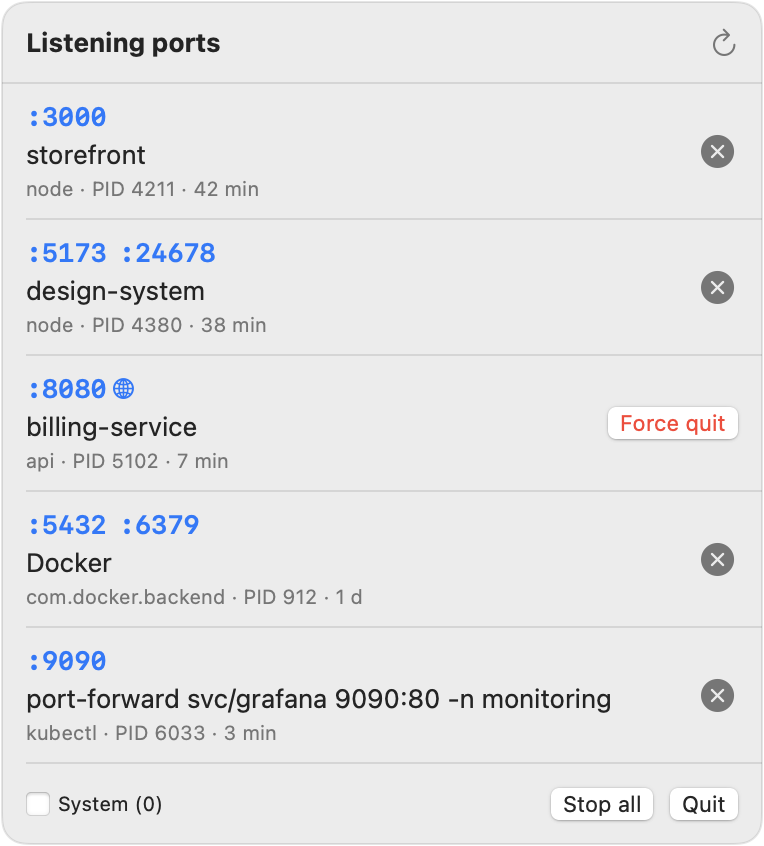

# PortKiller

A tiny macOS menu bar app that shows **what is listening on your ports** — and which project started it — and stops it in one click.

No more `lsof -i :3000 | grep LISTEN` followed by `kill -9` on the wrong PID.

<p align="center">
  <picture>
    <source media="(prefers-color-scheme: dark)" srcset="docs/dark.png">
    
  </picture>
</p>

## Features

- **Every TCP port in LISTEN state**, grouped by process, sorted by port.
- **Which project it belongs to** — the nearest folder with `.git`, `package.json` or `go.mod` above the process's working directory. `kubectl port-forward` shows its target instead.
- **🌐 marks ports reachable from the network** (bound to `*` / `0.0.0.0` instead of `127.0.0.1`) — handy before you join café Wi‑Fi.
- **Click a port** to open `http://localhost:<port>`.
- **✕ sends SIGTERM.** If the process is still alive after 2 s, a **Force quit** button sends SIGKILL.
- **Stop all** (with confirmation) for the end of the day.
- macOS services and helpers of GUI apps (AirPlay, VS Code, …) are hidden by default; Docker, OrbStack, Ollama and Postgres always show up.
- Refreshes when you open the menu — no background polling, no network access, no telemetry.

## Install

Requires macOS 14+ and the Swift toolchain (`xcode-select --install`).

```sh
git clone https://github.com/sobczykm/port-killer.git
cd port-killer
./build.sh run          # builds build/PortKiller.app and launches it
```

Move `build/PortKiller.app` to `/Applications` to keep it. There are no prebuilt binaries yet — unsigned downloads get blocked by Gatekeeper, so building locally is the smoothest path.

## Command line

```sh
build/PortKiller.app/Contents/MacOS/PortKiller --list
```

prints the same list in the terminal (`*` = reachable from the network, `[sys]` = hidden by default).

## How it works

| | |
|---|---|
| Listening sockets | `lsof -nP -iTCP -sTCP:LISTEN -F` (~30 ms) |
| Executable, working directory, start time | `libproc` (`proc_pidpath`, `proc_pidinfo`) |
| Command line | one `ps -o pid=,args=` call for all PIDs |
| Stopping | `kill(2)` — SIGTERM, then SIGKILL on request |

PortKiller runs as your user, so it only sees and stops your own processes — no root, no helper tools.

It is not on the Mac App Store on purpose: the App Sandbox does not allow inspecting or signalling other processes.

## License

[MIT](LICENSE) — provided "as is", without warranty of any kind. Stopping a process loses its unsaved state; you are clicking the ✕.
